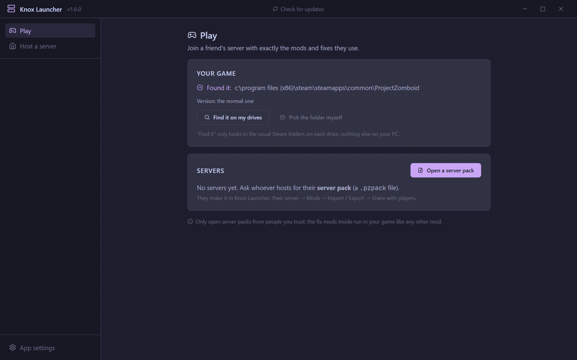
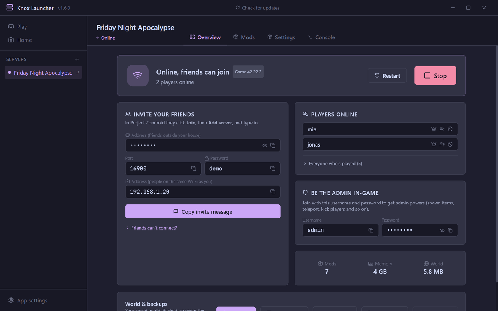
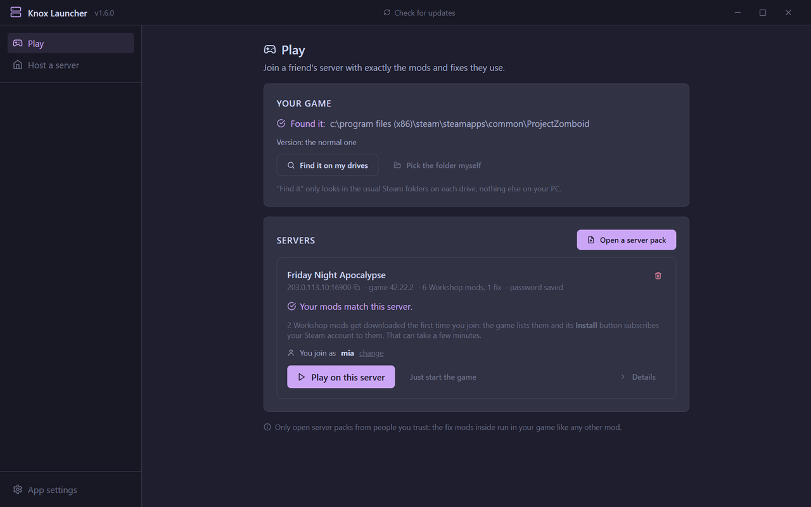
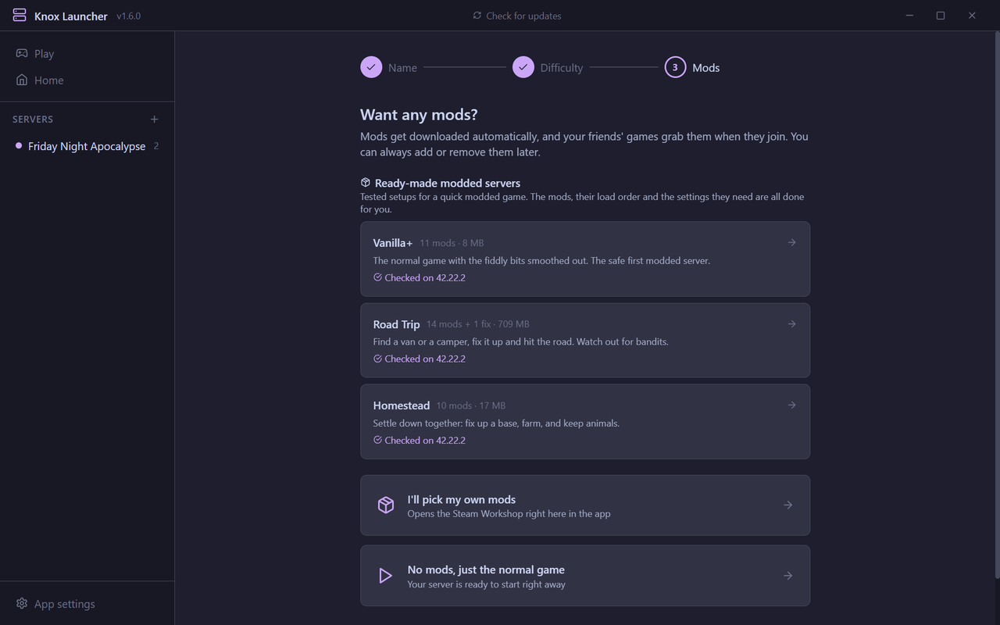
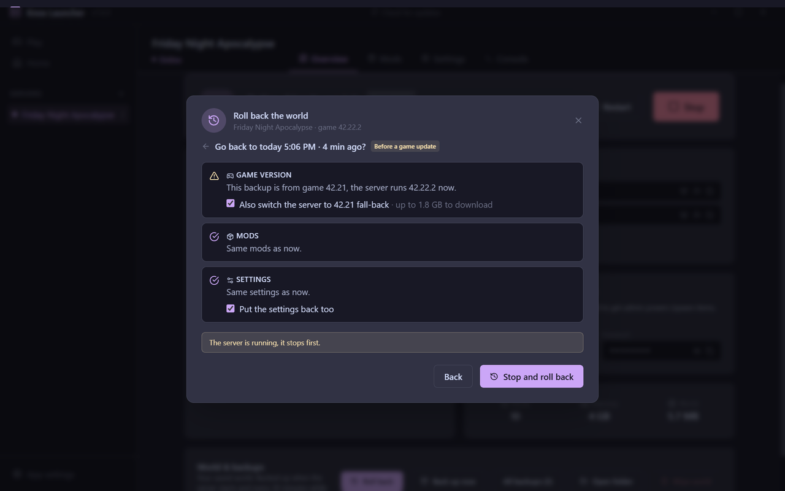

# Knox Launcher: Project Zomboid server manager for Windows

host a Project Zomboid server without touching ini files or command lines, or join a friend's with exactly their mods and fixes. free, open source, Build 42 ready.

**[download for Windows](https://github.com/Naftaliro/pz-server-manager/releases/latest)** · [website and guides](https://3hz.dev/knox/) · *(used to be called PZ Server Manager)*



| host | join |
|---|---|
|  |  |

## download

grab `Knox-Launcher-Setup-x.x.x.exe` from [releases](https://github.com/Naftaliro/pz-server-manager/releases/latest) and run it. it installs, puts a shortcut on your desktop and opens. prefer portable? grab the zip and run `PZ Server Manager.exe` from the extracted folder (the exe kept its old name).

Windows 10 or 11, 64-bit. the app is signed, so Windows shows the publisher as **Mitchell Berg**. for a while after a new release Windows might still say it "protected your pc", because it wants to see enough downloads first. click **more info**, check the publisher says Mitchell Berg, then **run anyway**.

## new in 1.6

- **roll back** after a bad game update, game version included, and an **update guard** so the next one waits for you (see below)
- **ready-made modded servers**: Vanilla+, Road Trip and Homestead. tested setups where the mods, load order and settings are done for you, each one test-started on the current game version
- **backups that have everything**: the world plus its settings, players, mod list and game version, every start and every 30 minutes while people play. they only store what changed
- **a broken mod says so**: if a mod stops the world loading, the app tells you which one and why, instead of sitting on "starting up" forever
- **server settings that work**: they come from the game's own files, so the B42 presets (loot, zombies, xp) actually apply, and starting a server no longer resets mod settings
- **host a copy of any server**: server packs can carry the server's settings, and anyone can make a new server from a pack
- **mod backups**: keeps a copy of every Workshop mod, switches to the saved copy if a mod is pulled or an update breaks it
- **modpacks that sort themselves**: paste a Workshop collection and it adds the mods they need, leaves out Build 41 mods and sorts the load order
- **every server gets its own folder**, so two servers can run side by side
- **everyone who's played**: a list on the overview, with ban and unban (Build 42 bans show up properly now)
- **streamer friendly**: hide your public IP and admin password on screen
- **start servers when the app opens**, and start the app with Windows
- **signed releases**, and the updater checks an update is signed before it installs it
- the little things: real download progress, the back and forward buttons on your mouse work, only one copy of the app runs at a time, and server pages are faster and don't freeze

## joining a friend's server

1. pick **play on a friend's server** the first time it opens. no server download needed
2. the host sends you a server pack (a small `.pzpack` file, discord works). open it under **play**
3. it checks your mods against theirs and installs the host's fix mods with one click. Workshop mods download by themselves the first time you join
4. pick your username in the app, hit **play on this server**. the game starts and joins. the game makes your account the first time you join with a new name, and the app tells you exactly what to type (your password is already copied)

it finds the game through Steam on any drive, or **find it** checks the usual Steam folders. only open server packs from people you trust: the fix mods inside run in your game like any other mod.

## hosting

1. the setup screen downloads the game server for you (~7 GB, one time), or uses the one already in your Steam library
2. **create a server**: name, difficulty (the game's own B42 presets: Apocalypse, Outbreak, Extinction, Rising), then mods: pick a ready-made modded server, your own mods, or none
3. hit **start**. it checks ports, memory and missing mods first. the first start with mods can take a few minutes
4. when it says **online**, copy the invite message from the overview, or send a server pack (mods → import / export → share with players)

got a `.pzpack` from someone? new server → **copy a server pack instead** hosts the same server: their mods, fix mods and settings, with a fresh world.

## ready-made modded servers

want mods but not the homework? on the mods step of a new server, pick one:

| | what it is | size |
|---|---|---|
| **Vanilla+** | the normal game with the fiddly bits smoothed out. the safe first modded server | 11 mods · 8 MB |
| **Road Trip** | find a van or a camper, fix it up and hit the road. RVs you can walk inside, guns, bandits | 15 mods · 709 MB |
| **Homestead** | settle down together: fix up a base, farm, keep animals | 10 mods · 17 MB |

the mods, their load order and the settings they need are done for you, mod backups get turned on, and friends join with one server pack (fix mods included). each one is test-started on a real server, and the card says which game version it was checked on.



## roll back

game updates break servers. Build 42.22.2 hit the public branch on november 9, 2026, and going back used to mean digging through save folders and SteamCMD commands. in 1.6 it's a button on the overview:

- **plain options**: before the last game update, about an hour ago, yesterday, last week, or any backup from the list
- **it checks first**: game version, mods and settings, and what would change
- **it switches the game version too**: if the backup is from an older version and Steam still has it (like the 42.21 fall-back), the server goes back to it. your players get the exact steps for their own game
- **undo**: the world as it is now gets backed up first, so a rollback can be undone
- **update guard**: game server updates wait until you hit **back up & update**

one thing to know: a world that's been opened on a newer game version can't go back to an older one (the game upgrades the save). so the backup from *before* the update is the one that counts, and the app makes it automatically before the new version touches the world. the app will refuse to put a newer world on an older game rather than break it.

what it can't do: switch your friends' games (everyone picks their own version in Steam, the app tells them what to pick), hold updates for a server installed through your Steam library (Steam updates those itself, so the app backs up before the new version first loads the world), or bring back an old version of a mod (the Workshop only serves the newest, so turn on mod backups).



## everything it does

**mods**
- the real Steam Workshop right inside the app. hit **+ add** on any mod, required mods get added too, whole collections work
- mods download straight away and the app reads the actual mod ids out of the files (no more guessing ids from the description)
- warns when a mod needs another mod you don't have, adds map mods to the map list for you
- load order: drag to reorder, or **sort automatically** using what each mod says it needs (`require`, `loadModAfter`, `loadModBefore`). warns about mods that clash or are made for the other build
- **ready-made modded servers**: Vanilla+, Road Trip and Homestead, see above
- **modpacks**: paste a workshop collection link to add everything in it (with the mods they need, build 41 mods left out, sorted once downloaded), or check how your list compares
- **mod backups**: a copy of every Workshop mod your servers use (last 2 versions each), switch to it from the mods tab
- import a mod list from any server `.ini`, or share yours

**running it**
- checks everything before starting (ports, memory, missing mods) and tells you how to fix it
- knows when the server is actually ready, and when a start fails it says why and which mod did it
- shows who's online, console with commands over rcon
- backs up the world (plus its settings, players and mod list) every start and every 30 minutes while people play. backups only store what changed, and older ones thin out by themselves
- roll back to any backup, game version included, with undo
- game server updates wait until you hit **back up & update** (or turn that off). shows which game version and Steam branch the server runs, and you can pick any branch Steam has
- each server has its own folder, so two can run at once
- restarts by itself if it crashes, when a mod updates (warns players in chat first) or once a day
- start servers when the app opens, start the app with Windows
- kick / ban / make admin from the players list, and everyone who's ever played with unban
- discord notifications: online (with the address), crashes, restarts, and player joins if you want
- every server and sandbox setting is still there under **more settings**, and there's an advanced mode for raw files, mod ids, ports, launch modes and b41

**friends connecting**
- "invite your friends" box with a copy-paste invite message
- step by step guide for [playit.gg](https://playit.gg) so friends can join without touching your router, and the invite shows your playit address (playit is its own free service, not affiliated with this app)
- checks your router (upnp), sets up a windows firewall rule that only opens the game ports, warns when the server is out of date

**the app**
- updates itself, and only installs updates signed the same way
- no accounts, no telemetry, no ads
- hide your public IP and admin password on screen, for streams and screenshots
- the back and forward buttons on your mouse (and alt + arrow keys) move between pages, and ask first if you have unsaved changes
- **copy diagnostics** in app settings for bug reports: a short summary of the last start, with passwords, IPs and Steam IDs left out

## friends can't join?

easiest: follow the playit.gg guide in app settings and paste your playit address on the overview page. otherwise the overview page has a "friends can't connect?" guide, short version:

- let the app add the windows firewall rule (app settings, or the fix button before starting)
- forward **udp 16261 and 16262** on your router to your pc (the app tries upnp first, lots of routers block it)
- everyone needs the same game version as the server. on the normal version, no beta branches. on a fall-back like 42.21, everyone picks that in Steam (right-click Project Zomboid → properties → game versions & betas). the overview says which one the server runs

the long version, with CGNAT and accounts and mods: [friends can't join your Project Zomboid server](https://3hz.dev/knox/guides/friends-cant-join-project-zomboid-server/).

## faq

**is it free?** yes. MIT license, no paid version, no ads, no account.

**do i need to buy anything to host?** no. the dedicated server is a free download from Steam and the app gets it for you. everyone who plays needs the game.

**build 41?** turn on advanced mode in app settings and pick build 41. it uses the `legacy41` branch.

**can i host and play on the same pc?** yes. leave enough memory for your own game (the memory slider shows what your pc has) and join with the "same wi-fi" address.

**a mod got pulled from the workshop / an update broke it?** if mod backups were on, the mods tab can switch to your saved copy. friends get it from your server pack (packs can hold up to 50 MB).

**mac or linux?** not right now, Windows only.

**something broken?** app settings → **copy diagnostics**, then [open an issue](https://github.com/Naftaliro/pz-server-manager/issues/new/choose) and paste it in. read it first, it has your server names and the end of your server logs.

more guides: [host a Build 42 server](https://3hz.dev/knox/guides/host-project-zomboid-server-windows/) · [add mods to a server](https://3hz.dev/knox/guides/project-zomboid-server-mods/) · [roll back after the 42.22 update](https://3hz.dev/knox/guides/roll-back-project-zomboid-server-update/)

## where stuff lives

- server files: `C:\PZServer` (or wherever you picked), mods download to `steamapps\workshop` in there
- each server's own folder (new in 1.6): `%USERPROFILE%\Zomboid\Knox servers\[ServerName]\`. servers made before 1.6 keep using `%USERPROFILE%\Zomboid\` until you hit **give this server its own folder** in its settings. in that folder:
  - server config: `Server\[ServerName].ini` and `_SandboxVars.lua`
  - world saves: `Saves\Multiplayer\[ServerName]\`
  - world backups: `pzm-backups\[ServerName]\`, one folder each. files that didn't change are hard links to the backup before, so every folder is a complete backup on its own and any of them can be deleted
  - server log: `server-console.txt`
- mod backups: `%USERPROFILE%\Zomboid\Knox mod backups\` (or wherever you picked)
- the app's own stuff: `%APPDATA%\pz-server-manager\` (`profiles.json`, `settings.json`)
- one Windows setting: QuickEdit is turned off for the server's console window only (`HKCU\Console\PZ Server - [ServerName]`), because clicking inside that window would freeze the server

fix mods that aren't on the workshop are explained in [local-mods/README.md](local-mods/README.md).

## building it

needs node 22 (22.12 or newer) or node 24. the test runner skips the odd versions in between.

```bash
npm install
npm run dev        # dev mode
npm test           # tests
npm run build:win  # windows build, ends up in release/
```

the ready-made modded servers are checked with `scripts/verify-presets.mjs`: `refresh` re-reads the mods after changing a list, and `verify --update` test-starts each one on a real dedicated server. run it after every game update and before every release, then commit `src/lib/presetData.json` (the app's "checked on 42.x" badge comes from it). details in the script's `--help`.

made with electron, react, typescript, tailwind, zustand and vite. catppuccin mocha forever.

## Code signing policy

Releases are signed with [Microsoft Artifact Signing](https://learn.microsoft.com/azure/artifact-signing/overview), certificate issued to Mitchell Berg. They're built and signed by [GitHub Actions](.github/workflows/build.yml) straight from this repo. Who can commit and approve releases, what gets signed and the privacy policy are in [CODE_SIGNING_POLICY.md](CODE_SIGNING_POLICY.md).

## license

[MIT](LICENSE)

---

Knox Launcher is an unofficial, fan-made tool. it isn't affiliated with or endorsed by The Indie Stone. Project Zomboid is a game by The Indie Stone, Steam and the Steam Workshop belong to Valve.
